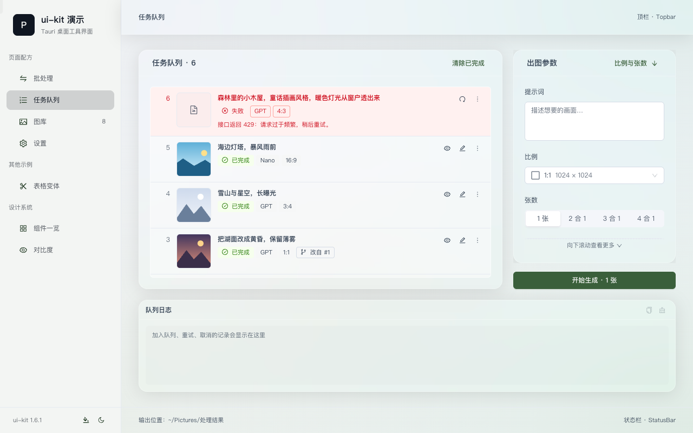
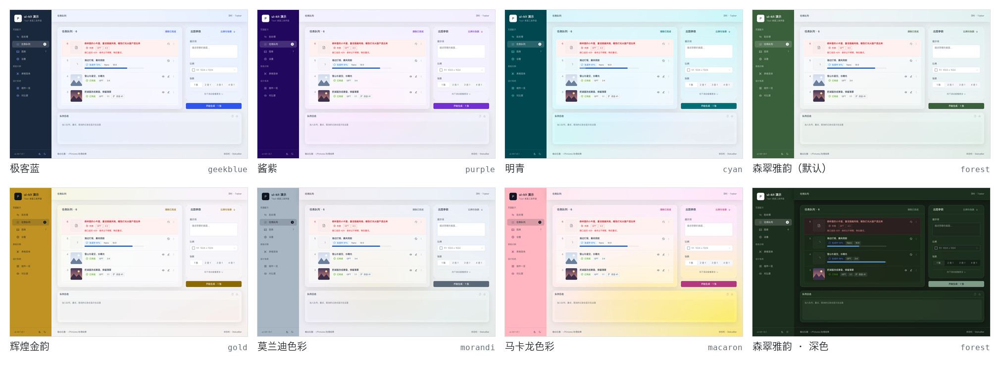

# ui-kit

Tauri 2 + React 19 + Ant Design 6 的桌面界面套件：在 antd 之上补齐 12px 高密度正文、AA 对比度、7 套主题、毛玻璃、桌面页面骨架和 Tauri 集成，以源码方式拷入项目使用。

[](CHANGELOG.md)




## 目录

- [它是什么](#它是什么)
- [主题一览](#主题一览)
- [组件清单](#组件清单)
- [接入](#接入)
  - [桌面项目](#桌面项目)
  - [网页项目](#网页项目)
- [升级](#升级)
- [目录结构](#目录结构)
- [使用它的项目](#使用它的项目)
- [参考速查](#参考速查)

## 它是什么

以 **Ant Design v6** 为主：控件、动效、主题系统、色彩体系都用 antd。ui-kit 只补 antd 没覆盖的部分。

| 来源 | 拿来了什么 |
|---|---|
| **Ant Design v6** | 全部控件、动效、`ConfigProvider` 主题、12 色板色彩体系、[antd design.md](https://ant.design/design.md) 设计语言 |
| **Tailwind CSS v3** | 只负责布局（flex / grid / 间距 / 尺寸）和自写元素的颜色；所有值读 antd token |
| **ui-kit**（本仓库） | 主题规范 `antd-theme.ts`（7 套主题、档位规则、侧栏、毛玻璃）、应用级组件、四个页面配方、Tauri hooks、应用图标脚本、对比度审计 |

三份文档分工如下，README 只做导览：

| 文档 | 内容 |
|---|---|
| [design.md](design.md) | 设计规范：继承 antd design.md，只写差异（字号、对比度、主题、侧栏、毛玻璃、页面骨架、组件用法约束） |
| [AI_GUIDE.md](AI_GUIDE.md) | 逐步接入指令：依赖、配置、入口、页面配方、Rust 端约定、完成后自检（写给 AI，也适合人照做） |
| [CHANGELOG.md](CHANGELOG.md) | 各版本变化与「从上一版升级」步骤 |

本地看效果：

```bash
cd demo && npm install && npm run dev   # http://localhost:5180
```

demo 包含四个页面配方（批处理 / 任务队列 / 图库 / 设置）、表格变体、组件一览和对比度页，侧栏底部可以切换主题和明暗。

## 主题一览

主题由 `<ThemeProvider accent>` 指定，一个主题 = 交互主色种子 + 一组配色：种子按档位规则推出按钮、链接等交互色（保证 AA），配色用在侧栏、毛玻璃背景和主题选择器上。功能色（成功 / 警告 / 危险 / 信息）不随主题变化。



| 主题 | `accent` | 来源 | 适合 | 使用约束 |
|---|---|---|---|---|
| 极客蓝 | `geekblue` | antd 色板 | 偏正式的工具、网页后台；侧栏为深蓝墨色 | — |
| 酱紫 | `purple` | antd 色板 | 需要和常见蓝色工具区分开时 | 深色下与危险色较近（ΔE ≈ 12） |
| 明青 | `cyan` | antd 色板 | 清爽的青色调 | — |
| **森翠雅韵**（默认） | `forest` | 自定义 | 通用；ui-kit 的默认外观 | 与「成功」同色系，成功状态必须带图标 |
| 辉煌金韵 | `gold` | 自定义 | 暖色、醒目 | 与「警告」同色系，警告状态必须带图标 |
| 莫兰迪色彩 | `morandi` | 自定义 | 低饱和，长时间使用不刺眼 | 深色下与危险色较近（ΔE ≈ 12） |
| 马卡龙色彩 | `macaron` | 自定义 | 轻松的图片、创作类工具 | 与「危险」相近：页面上不出现实心危险按钮 |

默认外观（`DEFAULTS`）是森翠雅韵 · 浅色 · 浅色侧栏 · 毛玻璃。`ThemeProvider` 的常用参数：

| 参数 | 取值 | 说明 |
|---|---|---|
| `accent` | 上表的 `accent` | 不传时由 `ThemeProvider` 自己保存（`localStorage`），用 `ThemeMenu` / `ThemePicker` / `useTheme().setAccent` 切换 |
| `mode` | `light` / `dark` / `system` | 同上；不传时自己保存 |
| `sidebar` | `light`（默认）/ `theme` | 浅色模式下的侧栏：主题色浅底或主题色；深色模式下始终是主题色 |
| `glass` | `true`（默认）/ `false` | 毛玻璃：卡片变成半透明玻璃面，背景换成主题配色的渐变 |
| `onAccentChange` / `onModeChange` | 回调 | 主题要存进应用自己的设置文件时使用（写法见 [AI_GUIDE 第 5 步](AI_GUIDE.md#主题存进应用自己的设置文件受控主题)） |

各主题的配色、实心色、侧栏色、区分度数值，以及侧栏、毛玻璃、深色表面的推导规则，见 [design.md「Colors」](design.md#colors)。新增主题：在 `antd-theme.ts` 的 `THEMES` 里加一项，再跑下面的审计。

### 对比度审计

正文 11–12px 属于小字，所有文字 / 背景组合按 WCAG AA **4.5:1** 校验，图标 3:1。审计覆盖 7 套主题 × 深浅 × 侧栏样式 × 毛玻璃开关，共 **42 种组合**：每种 70 组对比度，毛玻璃组合 168 组（额外逐个背景色块检查卡片文字、列表、表头、日志和状态栏），外加 3 组主色与危险 / 警告 / 成功的区分度（OKLab ΔE）。

```bash
cd demo && npm run check:contrast
```

对比度不达标时退出码为 1；区分度不足只警告（就是上表「使用约束」里那几项）。demo 的「对比度」页是同一份清单（`lib/audit.ts`）的可视化。**改任何颜色后都要跑一遍，必须全绿。**

## 组件清单

控件（Button、Input、Select、Table、Modal…）直接从 `antd` 导入；下面是 ui-kit 补充的部分，都从 `./ui-kit` 导入。每个组件的用法约束见 [design.md「Components」](design.md#components)，速查表见 [AI_GUIDE「组件速查」](AI_GUIDE.md#组件速查从-ui-kit-导入)。

**应用骨架**

| 组件 | 用途 |
|---|---|
| `AppShell` | 侧栏 + 主区外壳：品牌、分组导航、侧栏底栏、顶栏 / 状态栏插槽 |
| `Topbar` / `StatusBar` | 主区顶栏、底部状态栏（毛玻璃下状态栏透明，与侧栏底栏等高同线） |
| `Page` / `PageHeader` | 页面容器（默认撑满不滚动）、页面标题区 |
| `Workspace` | 左列表 + 右设置栏（统一 300px），`asideFooter` 放常驻主按钮 |
| `Panel` | 卡片（antd Card），`fill` 时内容区撑满并可滚动 |
| `NavBadge` | 侧栏导航徽标：进行中数量 / 弱化的总数 |
| `ErrorBoundary` | 渲染出错兜底，整窗或单页（`size="page"`） |

**列表与图片**

| 组件 | 用途 |
|---|---|
| `DropZone` | 拖拽区视觉提示 + 点击选择文件 |
| `ListWell` | 列表 / 表格的内嵌滚动容器 |
| `FileRow` / `FailedMark` | 文件名列表行（含失败状态）、失败标记；`FILE_ROW_ERROR_CLASS` 给 antd Table 标红失败行 |
| `ListRow` / `useRowFlash` | 富列表行（缩略图、多行信息、行尾操作、选中 / 失败 / 定位高亮），定位后闪烁并滚到可见 |
| `LinkTag` | 可点击的标签，用于跳转、定位（如「改自 #7」） |
| `Thumb` / `ThumbStrip` | 本地图片缩略图、缩略图条（支持 `fit="cover" \| "contain"`） |
| `ImageBadge` | 图片上的角标 |
| `ImageGrid` | 可选中的图片瓦片网格，双击看大图，选中项自动滚到可见 |
| `RatioIcon` / `RatioSelect` / `RatioPreview` | 比例图示、比例选择器、宫格预览 |

**表单与设置**

| 组件 | 用途 |
|---|---|
| `SettingsSection` | 设置页分区（标题、说明、右侧操作） |
| `SettingsScroll` | 设置 / 参数区的滚动容器，内容超出时在下方提示「向下滚动查看更多」 |
| `AdvancedSection` | 「高级」折叠，显示已改项数，可放「恢复默认」 |
| `ScrollArea` | 通用纵向滚动区，带同样的下方提示行 |
| `ScrollField` / `useFieldScroll` | 字段锚点，按字段名滚到指定表单项 |
| `FieldHint` | 右栏参数的提示 / 警示（不用 Alert） |

**反馈与日志**

| 组件 | 用途 |
|---|---|
| `LogViewer` / `LogActions` | 彩色日志（跟随但可上翻），标题栏的复制全部 / 清空按钮 |
| `useLogger` / `pushLog` | 每页一份日志状态；组件外或页面挂载前按通道写日志 |
| `ProgressPanel` | 批处理进度（antd Progress） |
| `StatusTag` | 带图标的状态标签预设：排队 / 进行中 / 成功 / 失败 / 警告 / 已取消 |
| `EmptyState` | 图标 + 文案 + 操作的空状态 |

**主题切换**

| 组件 | 用途 |
|---|---|
| `ThemeProvider` / `useTheme` | 唯一入口：包好 `StyleProvider` → `ConfigProvider`（主题 + 中文语言包）→ antd `App`，并把 token 写成 CSS 变量 |
| `ThemeMenu` | 侧栏底部的主题下拉菜单 |
| `ThemeToggle` | 浅色 / 深色切换按钮 |
| `ThemePicker` | 设置页的主题卡片选择（带配色色块和区分度提示） |

**Tauri 集成**

| 名称 | 用途 |
|---|---|
| `useFileDrop` | 窗口级拖拽，拿得到真实文件路径（WebView 里不要用 `Upload.Dragger`） |
| `useBatchProgress` | 订阅 Rust 批处理进度事件，配合 `ProgressPanel` |
| `useTaskEvents` / `createMockTaskBackend` | 订阅 Rust 多任务队列事件（`task-updated` / `task-removed`）；内存模拟后端用于 demo 与测试 |
| `tauri/tauri.conf.snippet.json` | 窗口尺寸、CSP、assetProtocol 配置片段 |
| `scripts/icon/make-icons.sh` | 应用图标：SVG → 透明 PNG → `tauri icon` → 逐尺寸校验四角透明（macOS） |

**页面配方**：`recipes/` 下有批处理页、任务队列页、图库页、设置页四个完整可运行的页面，拷到项目里再改。各配方的适用场景和数据层写法见 [AI_GUIDE 第 6 步](AI_GUIDE.md#第-6-步先选配方再写页面)。

## 接入

### 桌面项目

Tauri 2 项目引入完整的 ui-kit（不含 `demo/` 和 `docs/`）。下面是要点，逐步细节见 [AI_GUIDE.md](AI_GUIDE.md)。

**1. 拷贝目录**到 `src/ui-kit/`：

```bash
git clone https://github.com/byttao/ui-kit.git /tmp/ui-kit
rsync -a --exclude demo --exclude docs --exclude .git /tmp/ui-kit/ src/ui-kit/
cp src/ui-kit/theme-init.js public/theme-init.js
```

**2. 安装依赖**（版本与 demo 一致）：

```bash
npm i antd@^6.6 @ant-design/cssinjs@^2.1 @ant-design/colors@^8 @ant-design/icons@^6 clsx tailwind-merge
npm i -D tailwindcss@3 postcss autoprefixer
npm run tauri add dialog     # 文件选择框
npm run tauri add opener     # 打开链接、在访达 / 资源管理器中显示
```

- `npm ls @ant-design/cssinjs` 只应出现一个版本（必须与 antd 依赖的一致）。
- `src-tauri/capabilities/default.json` 的 `permissions` 要有 `"dialog:default"`、`"opener:default"`。

**3. Tauri 配置**

- 把 `src/ui-kit/tauri/tauri.conf.snippet.json` 的 `app` 合并进 `src-tauri/tauri.conf.json`（窗口最小 1100 × 700、CSP、assetProtocol）。
- `src-tauri/Cargo.toml` 的 tauri 依赖开启 `protocol-asset`，否则开了 assetProtocol 会编译报错：

```toml
tauri = { version = "2", features = ["protocol-asset"] }
```

本地图片预览要三处同时配好：`protocol-asset` 特性、`assetProtocol.enable` + `scope`、CSP 的 `img-src` 放行 `asset: http://asset.localhost`。缺一项图片就是空白且不报错。

**4. Tailwind**

```js
// tailwind.config.cjs
module.exports = {
  presets: [require("./src/ui-kit/tailwind.preset.cjs")],
  content: ["./index.html", "./src/**/*.{ts,tsx}"],
};
```

```js
// postcss.config.cjs
module.exports = { plugins: { tailwindcss: {}, autoprefixer: {} } };
```

**5. 入口 CSS**：顺序不能换。

```css
/* src/index.css */
@layer tailwind-base, antd;

@import "./ui-kit/styles/base.css";

@layer tailwind-base {
  @tailwind base;
}
@tailwind components;
@tailwind utilities;
```

第一行决定层级：Tailwind 的基础重置排在 antd 之下（否则 preflight 会把 antd 按钮的背景清成透明），工具类不分层、优先级最高（写在 antd 组件上的 Tailwind 类能生效）。

**6. HTML**：在 `index.html` 的 `<head>` 里加 `<script src="/theme-init.js"></script>`，首帧前设好明暗，启动不闪烁。

**7. Provider**

```tsx
// src/main.tsx
import { ErrorBoundary, ThemeProvider } from "./ui-kit";

<ThemeProvider>   {/* 默认：accent="forest" sidebar="light" glass */}
  <ErrorBoundary>
    <App />
  </ErrorBoundary>
</ThemeProvider>
```

`ThemeProvider` 已经包含 `StyleProvider layer`、`ConfigProvider` 和 antd `App`，不要再自己包一层 `ConfigProvider`。

接下来按 [AI_GUIDE 第 6 步](AI_GUIDE.md#第-6-步先选配方再写页面) 选配方写页面，Rust 端的事件约定见 [AI_GUIDE「Rust 端约定」](AI_GUIDE.md#rust-端约定)。

### 网页项目

网页项目只用 ui-kit 的主题部分，不用桌面专属的样式和 Tauri 集成：

| 拷入 | 不引入 |
|---|---|
| `antd-theme.ts`、`theme.tsx`、`lib/`、`tailwind.preset.cjs` | `styles/base.css`（整窗不滚动、默认禁止选中文字、12px 正文）、`tauri/` |

`theme-init.js` 可选：需要首帧就设好明暗时拷入；如果服务器不能直接提供这个静态文件，可以在构建时把它内联进 `index.html`。

```bash
git clone https://github.com/byttao/ui-kit.git /tmp/ui-kit
mkdir -p src/ui-kit
cp /tmp/ui-kit/{antd-theme.ts,theme.tsx,tailwind.preset.cjs} src/ui-kit/
rsync -a /tmp/ui-kit/lib/ src/ui-kit/lib/
npm i antd@^6.6 @ant-design/cssinjs@^2.1 @ant-design/colors@^8 @ant-design/icons@^6 clsx tailwind-merge
npm i -D tailwindcss@3 postcss autoprefixer
```

没有拷 `index.ts`，所以从 `./ui-kit/theme`、`./ui-kit/antd-theme` 导入。

**原则：不改 ui-kit 文件。** 字号、主色等差异都写在项目自己的包装层里，通过参数覆盖，升级时整目录覆盖即可。以编号软件（业码汇）的网页前端为例，它的包装层做了这几件事：

1. 主色、侧栏、毛玻璃用 `ThemeProvider` 的参数指定：`accent="geekblue" sidebar="light" glass={false}`。
2. 正文改为 14px：在 `ThemeProvider` 里面嵌套一层 `ConfigProvider`，只覆盖字号种子，标题、行高仍由 antd 推导；再包一层 antd `App`，让 `App.useApp()` 的 message / modal 也用 14px。
3. `ThemeProvider` 写在 `<html>` 上的 CSS 变量仍是 12px，Tailwind 的 `text-base` 等类读的是这些变量。包装层用 `buildTheme` + `antd` 的 `theme.getDesignToken` 算出 14px 与 12px 两套 token 的差异，把有差异的变量（`--ant-font-size` 等，变量名用 `toKebab` 转换）写到 `<body>` 上，页面元素就近继承。

```tsx
// src/theme/AppThemeProvider.tsx（简化）
import { App as AntApp, ConfigProvider, type ThemeConfig } from "antd";
import { ThemeProvider } from "@/ui-kit/theme";

const WEB_THEME: ThemeConfig = { token: { fontSize: 14, fontSizeSM: 12 } };

export function AppThemeProvider({ children }: { children: React.ReactNode }) {
  return (
    <ThemeProvider accent="geekblue" sidebar="light" glass={false}>
      <ConfigProvider theme={WEB_THEME}>
        <AntApp component={false}>{children}</AntApp>
      </ConfigProvider>
    </ThemeProvider>
  );
}
```

入口 CSS 保留层级声明，但不引入 `base.css`，自己写 `body` 的基础样式：

```css
/* src/index.css */
@layer tailwind-base, antd;

@layer tailwind-base {
  @tailwind base;
}
@tailwind components;
@tailwind utilities;

@layer base {
  body {
    margin: 0;
    min-height: 100vh;
    font-family: var(--ant-font-family);
    font-size: var(--ant-font-size, 14px);
    line-height: var(--ant-line-height, 1.5714);
    color: var(--ant-color-text);
    background-color: var(--ant-color-bg-layout);
  }
}
```

接好后在浏览器里确认：正文和输入框是 14px；**文字可以选中复制**（`user-select` 不是 `none`）；**页面能正常滚动**（`body` 没有 `overflow: hidden`）；`npm ls @ant-design/cssinjs` 只有一个版本。

## 升级

ui-kit 不发布到 npm，升级就是重新拷贝。桌面项目整目录覆盖：

```bash
rsync -a --delete --exclude demo --exclude docs --exclude .git --exclude .claude /tmp/ui-kit/ src/ui-kit/
```

网页项目重新拷贝上面那四项即可。项目里的版本可以读 `UI_KIT_VERSION`（桌面项目）；网页项目没有拷 `index.ts`，建议在 `src/ui-kit/` 旁记下拷入的版本和 commit。

升级前读 [CHANGELOG.md](CHANGELOG.md) 对应版本的「不兼容变化」和「从上一版升级」，按其中的步骤检查业务代码，再跑 `npm run build` 和 `antd lint`。

## 目录结构

```text
ui-kit/
├── package.json              版本号与依赖（peerDependencies），不发布到 npm
├── README.md                 本文件：导览
├── design.md                 设计差异（google design.md 格式，继承 antd design.md）
├── AI_GUIDE.md               逐步接入指令与自检
├── CHANGELOG.md              更新记录与升级步骤
├── index.ts                  统一出口（含 UI_KIT_VERSION）
├── antd-theme.ts             主题规范：主题（种子 + 配色）、功能色、档位规则、侧栏、毛玻璃 → ConfigProvider theme
├── theme.tsx                 ThemeProvider / useTheme（StyleProvider + ConfigProvider + App）
├── theme-init.js             首帧主题脚本（防闪烁）
├── tailwind.preset.cjs       Tailwind preset：颜色、字号、圆角、阴影、时长都指向 antd 变量
├── styles/
│   └── base.css              桌面化基础样式（滚动条、不可选中、减弱动效）
├── lib/
│   ├── cn.ts                 className 合并（已登记自定义刻度）
│   ├── contrast.ts           WCAG 对比度、OKLab ΔE
│   └── audit.ts              主题审计清单
├── components/app/           antd 没有的应用级组件
│   ├── app-shell.tsx         AppShell / Topbar / StatusBar / Page / PageHeader / Workspace / Panel
│   ├── nav-badge.tsx         NavBadge
│   ├── error-boundary.tsx    ErrorBoundary
│   ├── drop-zone.tsx         DropZone
│   ├── file-list.tsx         ListWell / FileRow / FailedMark / FILE_ROW_ERROR_CLASS / fileName
│   ├── list-row.tsx          ListRow / useRowFlash
│   ├── link-tag.tsx          LinkTag
│   ├── thumb.tsx             Thumb / ThumbStrip / ImageBadge / localImageSrc
│   ├── image-grid.tsx        ImageGrid
│   ├── ratio.tsx             RatioIcon / RatioSelect / RatioPreview / parseRatio
│   ├── settings-section.tsx  SettingsSection / SettingsScroll / AdvancedSection
│   ├── scroll-area.tsx       ScrollArea / ScrollField / useFieldScroll / scrollToField
│   ├── field-hint.tsx        FieldHint
│   ├── log-viewer.tsx        LogViewer / LogActions / useLogger / pushLog
│   ├── progress-panel.tsx    ProgressPanel
│   ├── status-tag.tsx        StatusTag
│   ├── empty-state.tsx       EmptyState
│   ├── theme-toggle.tsx      ThemeToggle
│   ├── theme-menu.tsx        ThemeMenu
│   └── theme-picker.tsx      ThemePicker
├── tauri/
│   ├── useFileDrop.ts        窗口级拖拽（拿得到真实路径）
│   ├── useBatchProgress.ts   订阅 Rust 批处理进度事件
│   ├── useTaskEvents.ts      订阅 Rust 多任务队列事件 + createMockTaskBackend
│   └── tauri.conf.snippet.json  窗口 / CSP / assetProtocol 片段（含 Cargo 与插件权限说明）
├── recipes/                  页面配方（完整可运行，拷到项目里改）
│   ├── batch-page.tsx        批处理页
│   ├── queue-page.tsx        任务队列页
│   ├── gallery-page.tsx      图库页
│   ├── settings-page.tsx     设置页
│   └── mock.ts               demo / 测试用的内存数据层（不要拷进项目）
├── scripts/icon/             应用图标（macOS）
│   ├── make-icons.sh         SVG → 透明 PNG → tauri icon → 校验
│   ├── render-svg.swift      AppKit 渲染透明底 PNG
│   └── check-alpha.swift     逐尺寸校验四角透明
├── docs/images/              README 截图（不要拷进项目）
└── demo/                     演示与验证工程（不要拷进项目）
    ├── src/                  页面配方、表格变体、组件一览、对比度页
    └── scripts/check-contrast.mjs  主题审计（npm run check:contrast）
```

## 使用它的项目

| 项目 | 说明 |
|---|---|
| [huijing](https://github.com/byttao/huijing) | 绘境：AI 出图桌面应用，任务队列与多合一拆切 |
| [PigResizeF](https://github.com/byttao/PigResizeF) | 图片批量裁切与京东详情页分段导出 |
| [tb-goodpic](https://github.com/byttao/tb-goodpic) | 淘宝图片下载：批量下载主图、SKU 图和详情图 |
| [FirmMatterCodeManagement](https://github.com/byttao/FirmMatterCodeManagement) | 业码汇的网页前端，按「网页项目」方式接入（迁移进行中） |

另有若干内部工具（私有仓库）。

## 参考速查

<details>
<summary><strong>Token 与 Tailwind 类</strong></summary>

`ThemeProvider` 把 antd 解析后的全部 token 写到 `:root`（`--ant-color-primary`、`--ant-font-size`…）。preset 的类名 = antd token 去掉 `color` / `colorBg` 前缀：

| antd token | Tailwind 类 |
|---|---|
| `colorBgLayout` / `colorBgContainer` / `colorBgElevated` | `bg-layout` / `bg-container` / `bg-elevated` |
| `colorText` / `colorTextSecondary` / `colorTextTertiary` | `text-text` / `text-text-secondary` / `text-text-tertiary` |
| `colorBorder` / `colorBorderSecondary` | `border-border` / `border`（默认就是 secondary） |
| `colorPrimary` / `colorPrimaryBg` / `colorPrimaryText` | `bg-primary` / `bg-primary-bg` / `text-primary-text` |
| `colorSuccess` 等（Warning / Error / Info 同理） | `text-success`、`bg-success-bg`、`border-success-border` |
| `colorFillTertiary` / `colorFillQuaternary` / `colorFillAlter` | `bg-fill-tertiary` / `bg-fill-quaternary` / `bg-fill-alter` |
| `controlItemBgHover` / `controlItemBgActive` | `bg-item-hover` / `bg-item-active` |
| `fontSizeSM` / `fontSize` / `fontSizeLG` / `fontSizeXL` | `text-sm` 11 / `text-base` 12 / `text-lg` 14 / `text-xl` 16 |
| `fontSizeHeading1–5` | `text-h1` 32 … `text-h2` 26 … `text-h5` 14 |
| `borderRadiusXS / SM / 默认 / LG` | `rounded-xs` 2 / `rounded-sm` 4 / `rounded` 6 / `rounded-lg` 8 |
| `boxShadow` / `boxShadowSecondary` / `boxShadowCard` | `shadow` / `shadow-secondary` / `shadow-card` |
| `motionDurationFast / Mid / Slow` | `duration-fast` / `duration-mid` / `duration-slow` |
| `controlHeight / SM / LG` | `h-control` 32 / `h-control-sm` 24 / `h-control-lg` 40 |
| ui-kit 扩展 | `bg-sidebar`、`text-sidebar-text`、`text-log-info` … |

- 不要用透明度写法（`bg-primary/10`）：变量是完整颜色，不支持；要浅色用 antd 推导好的档位。
- 不要写色板类（`bg-orange-500`、`text-gray-400`）或内联十六进制：不随主题切换。
- 组件里需要数值时用 `theme.useToken()`；SVG 用同名的 `fill-*` / `stroke-*` 类。

</details>

<details>
<summary><strong>从 ui-kit v1（shadcn 结构）迁移</strong></summary>

| v1 写法 | 改成 |
|---|---|
| `<Button variant="primary">` / `secondary` / `ghost` / `text` / `destructive` | antd `<Button type="primary">` / 默认 / `type="dashed"` / `type="link"` / `danger` |
| `Card` + `CardHeader` / `CardTitle` / `CardContent` | `<Panel title extra>`（antd Card） |
| `Field` + `Input` / `Select` | `<Form layout="vertical"><Form.Item label extra>` + antd `Input` / `Select` |
| `Choice boxed` | `Radio.Group orientation="vertical"` |
| `Badge tone` / `Notice tone` | `Tag color` / `Alert type` |
| `Progress` | antd `Progress` |
| `ToastProvider` + `useToast()` | `App.useApp().message` |
| `ListRow` / `DataTable` / `EmptyState`（v1） | 1.3.0 起的 `ListRow` / antd `Table` / `EmptyState`（API 不同，按组件清单改写） |
| `accent="blue" \| "orange" \| "green"` | `accent` 取 `THEMES` 的键（橙色、拂晓蓝已停用）；`sidebar="dark"` 改为 `"theme"` |
| `bg-card` / `bg-background` / `text-muted-foreground` / `bg-accent` | `bg-container` / `bg-layout` / `text-text-secondary` / `bg-item-active` |
| `text-xs` 11 / `text-sm` 12 / `text-base` 14 | `text-sm` 11 / `text-base` 12 / `text-lg` 14 |
| `rounded-md` 8 / `rounded-xl` 14 | `rounded` 6 / `rounded-lg` 8 |
| `styles/tokens.css` | 删除，颜色由 `ThemeProvider` 写入 |

先换外壳（`ThemeProvider` + `AppShell`），再逐页把旧组件换成 antd 组件，每换一页对照截图检查。色板类和 `style={{ color: hsl(var(--…)) }}` 都改成语义类。

</details>

<details>
<summary><strong>桌面项目验收清单</strong></summary>

1. `npm run check:contrast` 没有对比度失败；区分度警告只出现在 design.md 主题表里加粗的那几项。
2. 浅色、深色、跟随系统都能切换，重启后保持；启动时无闪烁。
3. 只有一个主色；同一区域最多一个实心主按钮；实心危险按钮只在确认弹窗里出现。
4. 正文 12px、说明 11px、页面标题 26px；没有 14px / 16px 正文。
5. 控件 32px 高、6px 圆角；卡片 8px 圆角 + 1px 描边，没有大阴影。
6. Tab 键走一遍，每个可操作元素都有焦点提示。
7. 系统开启「减弱动态效果」后，Segmented、弹窗、下拉仍能正常切换和关闭，下拉出现在触发器旁边而不是屏幕外。
8. 开毛玻璃后逐个主题看一遍：卡片文字清楚、背景渐变不刺眼、深色下卡片不发灰；深色下主区颜色跟随主题。
9. 从访达 / 资源管理器拖文件到窗口任何位置都能添加。
10. 预览图能显示（asset 协议已开，Cargo 有 `protocol-asset`）。
11. 参数很多的页面，主按钮仍在可视区内（`asideFooter`）；切页后回来，日志与草稿还在（页面常驻）。
12. 处理时进度条连续前进，日志自动跟随但可以上翻。
13. 窗口缩到 1100px 宽：无横向滚动条、标签不截断、侧栏收窄到 195px。
14. Windows（WebView2）与 macOS（WKWebView）各看一次：滚动条宽度一致、字体不发虚。
15. 应用图标四角透明（`scripts/icon/check-alpha.swift` 全部 OK）。

代码层面的自检（禁用写法搜索等）见 [AI_GUIDE「完成后自检」](AI_GUIDE.md#完成后自检)。

</details>
